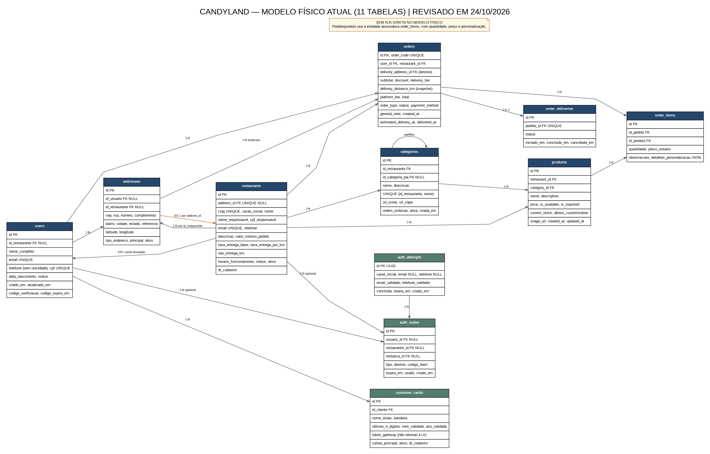

# Modelo físico de dados — CandyLand

> **Snapshot do código auditado em 24/10/2026.** Este diagrama descreve os modelos SQLAlchemy atuais, não um redesign futuro. A fonte de verdade para campos é `backend/app/models/`; sempre compare este documento com os modelos no mesmo PR.



Fonte editável: [`modelo-dados.dot`](modelo-dados.dot). Se Graphviz estiver instalado, regenere a imagem na raiz do projeto com:

```bash
dot -Tpng docs/modelo-dados.dot -o docs/modelo-dados.png  # saída em alta resolução
```

## Tabelas/modelos encontrados

| Tabela | Modelo | Papel |
|---|---|---|
| `users` | `Usuario` | Identidade do cliente/conta e referência opcional de restaurante. |
| `addresses` | `Endereco` | Endereços de usuário ou restaurante, CEP, coordenadas e status. |
| `restaurants` | `Restaurante` | Dados cadastrais, operação, taxa base e raio de entrega. |
| `categories` | `Categoria` | Categorias vinculadas a restaurante e categorias-pai. |
| `products` | `Produto` | Produtos, preços, disponibilidade, imagem por URL e estoque. |
| `orders` | `Pedido` | Pedido, valores, modalidade, status comercial e timestamps. |
| `order_items` | `ItemPedido` | Itens do pedido, quantidade, preço fotografado e personalização. |
| `order_deliveries` | `EntregaPedido` | Um registro logístico por pedido (`pedido_id` é único). |
| `auth_attempts` | `TentativaAutenticacao` | Tentativa/canal de autenticação, validações e expiração. |
| `auth_codes` | `CodigoAutenticacao` | Códigos de autenticação armazenados como hash e vínculo de tentativa. |
| `customer_cards` | `CartaoCliente` | Referência tokenizada e dados limitados do cartão para exibição. |

Total observado: **11 modelos/tabelas**. Não foram encontrados modelos/tabelas para pagamento/retorno de gateway, histórico de transições do pedido, motorista/entregador, nota fiscal ou notificações.

## Relacionamentos representados

**Não há relacionamento N:N direto declarado nos modelos SQLAlchemy.** A associação entre pedidos e produtos passa por `order_items`, que é uma entidade própria e armazena atributos do vínculo (`quantidade`, `preco_unitario`, `observacoes` e `detalhes_personalizacao`). Portanto, o modelo físico é `orders 1:N order_items` e `products 1:N order_items`, sem uma tabela de associação genérica ou um `secondary` N:N. Não é necessário alterar essa parte do schema para eliminar N:N direta.

- `users` 1:N `addresses`, `orders`, `auth_codes` e `customer_cards`.
- `restaurants` 1:N `products`, `categories`, `orders` e `auth_codes`.
- `categories` pode possuir categorias-filhas; `products` pertencem a categoria e restaurante.
- `orders` 1:N `order_items`; cada item referencia um produto. `orders` tem no máximo uma `order_deliveries` por causa da unicidade de `pedido_id`.
- `orders.delivery_address_id` aponta para `addresses.id`. Em `DELIVERY`, aponta para o endereço ativo do cliente; em `PICKUP`, aponta para o endereço ativo do restaurante. Essa é uma compatibilidade temporária do schema atual; no futuro, renomear para `destination_address_id` com migração explícita.
- `auth_codes.tentativa_id` aponta para `auth_attempts.id`.

## Restrições declaradas nos modelos SQLAlchemy

O ZIP analisado não contém um arquivo de banco de dados (`.db`/`.sqlite3`). As restrições abaixo foram confirmadas nos modelos SQLAlchemy; não afirmam que um banco persistido local ou de produção já esteja migrado para exatamente esse schema.

- `users`: `email` e `cpf` únicos dentro da tabela; `telefone` não possui restrição `UNIQUE` no banco.
- `restaurants`: `cnpj`, `address_id` e `email` únicos dentro da tabela; `email` possui restrição única e índice único explícito (`unique=True, index=True` no ORM), duplicidade de mecanismo que pode ser simplificada em migração futura.
- A unicidade global de e-mail entre `users` e `restaurants` é aplicada pelos serviços da aplicação; o banco atual não consegue impor essa regra com uma restrição `UNIQUE` simples cruzando tabelas. A duplicidade de telefone também é uma regra de aplicação, que pode ser habilitada somente em ambientes não produtivos.
- `categories`: combinação `(id_restaurante, nome)` única.
- `orders`: `order_code` único.
- `order_deliveries`: `pedido_id` único, garantindo no máximo uma entrega por pedido no modelo atual.
- As chaves estrangeiras declaradas nos modelos correspondem aos relacionamentos descritos acima. Para validar uma instalação persistida, inspecione o banco real e aplique migrações versionadas quando houver divergência.

## Pontos de atenção do modelo atual

1. **Vínculo circular entre restaurante e endereço:** `restaurants.address_id` referencia `addresses.id` e `addresses.id_restaurante` referencia `restaurants.id`. São duas referências para a relação física entre os mesmos conceitos, ambas nullable. Não remova nenhuma sem decidir a referência canônica, planejar migração e reconciliar os dados existentes.
2. **Pagamento ainda incompleto:** `orders.payment_method` armazena a modalidade (`PIX`/`CARTAO_CREDITO`), mas não há `payment_provider`, registro de cobrança, webhook ou tabela de transações. `customer_cards.token_gateway` é uma referência tokenizada de cartão, não integração de gateway.
3. **Sem histórico de status:** o status atual é sobrescrito em `orders.status` e `order_deliveries.status`; não há tabela de eventos para manter histórico/auditoria das transições.
4. **Entrega básica:** um único `order_deliveries` por pedido não representa histórico de múltiplas tentativas de motorista; por enquanto, isso está fora do modelo implementado.
5. **Default de pedido:** o serviço cria pedidos em `PENDENTE_PAGAMENTO`; o default Python do modelo foi alinhado com essa regra. Essa mudança de default no ORM não altera nem limpa registros existentes.
6. **Taxa por distância:** `restaurants.taxa_entrega_por_km` configura o adicional por km; `orders.delivery_distance_km` registra o snapshot da distância usada na cobrança. A migração aditiva `app/database/migrations.py` adiciona essas colunas aos bancos existentes de forma idempotente, sem apagar dados. `run.py` executa a verificação antes de consultar pedidos.
7. **Destino da retirada:** `orders.delivery_address_id` permanece NOT NULL por compatibilidade com o banco atual. Em pedidos `PICKUP`, guarda o endereço do restaurante; não houve alteração física na tabela nesta entrega. Uma futura renomeação para `destination_address_id` requer migração versionada.
8. **Sem framework de migração identificado:** `db.create_all()` é executado no arranque, mas não atualiza tabelas já existentes. Uma futura mudança estrutural exige backup e migração explícita; não apague o banco local para “atualizar” o diagrama.
9. **Validação do schema persistido pendente:** como o ZIP não contém o banco em uso, ainda é necessário comparar o schema real no ambiente de desenvolvimento/homologação antes de declarar que o banco físico está alinhado com todos os modelos.

## Regras de consistência com o banco

- Regras de negócio gerais: [`requisitos.md`](requisitos.md).
- Estados, transições e cancelamento: [`regras-pedidos.md`](regras-pedidos.md).
- Qualquer mudança de coluna, FK, unicidade, nullable, default com persistência ou relacionamento deve atualizar este Markdown, `modelo-dados.dot`, `modelo-dados.png` e testes.
- Regra de taxa: [`regras-pedidos.md`](regras-pedidos.md) descreve fórmula, limite do raio e o snapshot `delivery_distance_km`.
- Se o banco usado localmente divergir do modelo ORM, primeiro faça backup, compare schema/dados e prepare migração reversível. Nunca use `DROP TABLE`/delete do banco como correção automática.
